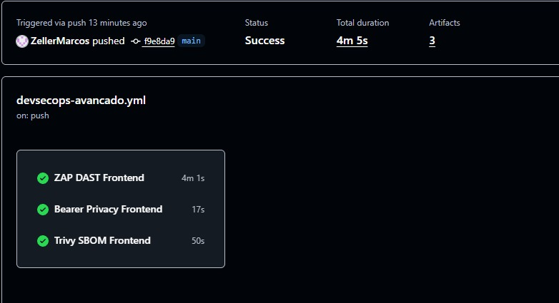
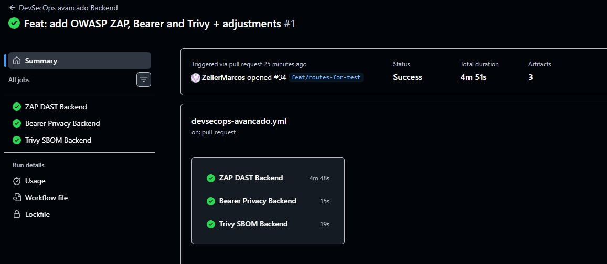
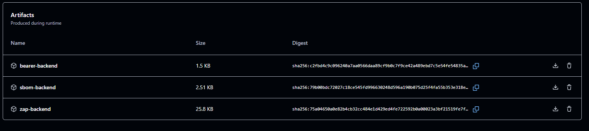
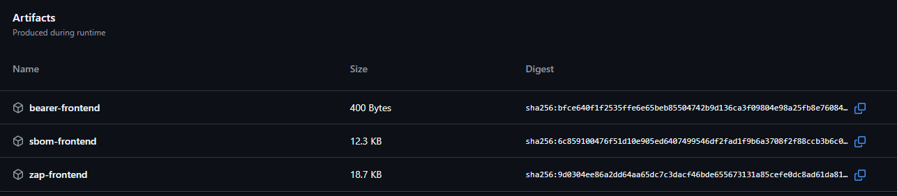
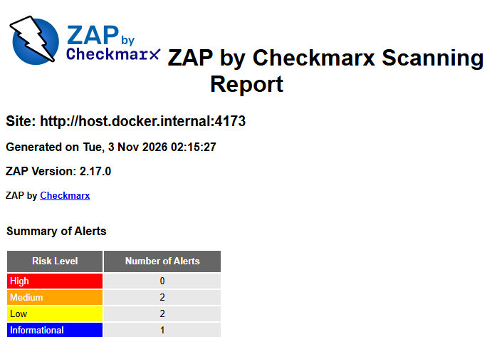
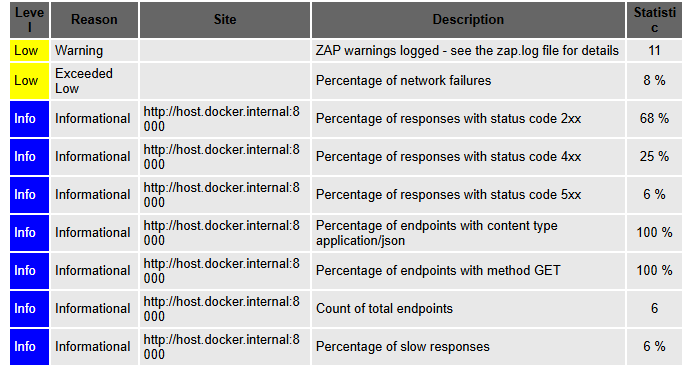

# Hemo Connect - Relatorio Tecnico DevSecOps Avancado

## Status da entrega

Execucoes locais iniciadas em 02/11/2026; atualizacao das evidencias GitHub
em 03/11/2026. Horarios das execucoes remotas sao registrados em UTC.
Autores conforme documentacao: Marcos Zeller e Willian Donizetti; UMC.
Consolidacao tecnica assistida por IA.

**Workflows publicados e execucoes GitHub aprovadas nos dois repositorios.
SBOMs remotos baixados e validados. Prints dos tres jobs verdes do frontend
e do backend inseridos, assim como as secoes de artefatos de ambos.
Capturas obrigatorias reunidas; permanecem as pendencias tecnicas e de
verificacao da protecao de branch descritas na secao 6.**

Inicialmente, o trabalho foi limitado ao ambiente local. Posteriormente,
o responsavel publicou os workflows e realizou os merges. As execucoes
e os artefatos foram verificados pela API do GitHub. A configuracao de
checks obrigatorios na protecao de branch ainda nao foi verificada;
merge bem-sucedido nao comprova bloqueio de futuros merges com falha.

Baselines historicas da analise local: backend `7363db1455c191306c5af9a30a850d367478c535`;
frontend `af546b038d0307635658cd463c475542e9531b84`.
Os commits das evidencias remotas sao identificados na secao 5.

## 1. Introducao a arquitetura open-source

O backend utiliza FastAPI, SQLAlchemy, PostgreSQL e Argon2id; o frontend,
React, TypeScript, Vite e npm. A esteira existente de testes/build,
Semgrep, TruffleHog e Trivy SCA foi preservada.

Cada repositorio recebe tres jobs independentes: ZAP DAST, Bearer e
Trivy SBOM. O workflow executa em PRs para main, pushes em main e
workflow_dispatch. Permissoes contents:read, Actions fixadas por commit,
imagens por digest e binarios/regras por SHA-256 reduzem riscos da esteira.
Timeouts, concorrencia e retencao de artefatos por 14 dias limitam recursos.

Fluxo previsto: codigo versionado -> runner Linux -> scanners -> relatorios
e SBOM -> artefatos para download -> checks exigidos na protecao de branch.
O YAML nao substitui a configuracao desses checks nem comprova uma execucao.

ZAP e Trivy sao open-source e nao exigem servico pago ou chave de API.
**Ressalva de licenciamento:** Bearer 2.1.3 e seu pacote de regras utilizam
Elastic License 2.0, verificada nas fontes oficiais. E uso gratuito para
esta execucao interna, mas source-available com restricoes, nao uma licenca
open-source aprovada pela OSI. Bearer foi mantido porque e exigido pelo
enunciado; o requisito literal "100% open-source" precisa ser alinhado
com o docente antes do aceite. Nao foi substituida a ferramenta sem autorizacao.
GitHub Actions e uma plataforma hospedada, nao integralmente open-source.
Runners padrao em repositorios publicos sao gratuitos; em privados, e
necessario respeitar a franquia. Os testes nao usam dados reais, Brevo,
Supabase ou API implantada.

## 2. Descritivo tecnico das ferramentas

### 2.1 OWASP ZAP - DAST

Foi executado ZAP 2.17.0, Java 17.0.21, com imagem linux/amd64 fixada no
digest `0075662e5c287cf0a68caebabbfea872e5dc461912ad6d7345fa02a290d0ccb6`.
O Docker local tornou-se disponivel apos inicializacao suportada; a
indisponibilidade anterior nao foi tratada como scan aprovado.

O backend usa PostgreSQL 16 descartavel, factory exclusiva de CI, contas
sinteticas de doador/administrador e adaptador local de e-mail. A factory
recusa banco remoto, nome/usuario diferente de hemo_dast, ambiente nao CI
e banco previamente populado. Login por senha e 2FA reais geram sessoes.

Corrigiu-se um defeito da fixture: enderecos .test eram recusados pelo
validador real de LoginRequest. Agora sao usados doador@example.com e
administrador@example.com, do dominio reservado example.com. O adaptador
aceita somente esses destinatarios e nao envia mensagens pela rede.
Um teste de regressao verifica os enderecos no modelo real.

A preparacao comprova 10 leituras autenticadas entre os dois perfis.
O ZAP utiliza OpenAPI filtrado, requestor com status 200, scan ativo e
espera passiva. O escopo GET inclui auth/me, usuarios, hemocentros,
hemocentros/1 e, para doador, agendamentos/me e historico/me.
Mutacoes destrutivas, logout e jornadas clinicas completas nao sao cobertos.

O frontend usa bundle local, requestor, spider e spiderAjax, com scan
passivo; nao cobre jornadas autenticadas completas nem scan ativo da SPA.
A API do build aponta para https://localhost:8000, nao para a implantacao.
No Windows, o scanner acessa os servicos via host.docker.internal;
o preview recebe allowlist explicita desse host. No CI Linux, utiliza-se
loopback e rede host. Essa adaptacao nao altera o deploy.

Tokens/planos privados nao sao artefatos; JSON/HTML sao sanitizados.
O ZAP bloqueia High, sua maior severidade, com exit-code 1.
Erros/warnings reportados pelo Automation Framework, falha de execucao e
relatorio ausente/invalido tambem bloqueiam. Os insights do relatorio nao
sao equivalentes a warnings do Automation Framework.

**Resultados:** frontend terminou com codigo 0, contendo 0 High,
2 Medium, 2 Low e 1 Informational, por classe de alerta.
Doador e administrador terminaram com codigo 0 e nenhuma classe de alerta.
Isso significa ausencia de High detectado nesse escopo, nao ausencia
de defeitos ou cobertura integral.

**Degradacao observada e nao encerrada:** o relatorio do doador registra
11 warnings internos, 8% de falhas de rede e 6% de respostas 5xx
(68% 2xx e 25% 4xx; percentuais arredondados pelo ZAP).
O log real da API mostrou 500 ao consultar hemocentros com identificadores
maiores que a faixa INTEGER do PostgreSQL, com NumericValueOutOfRange.
O erro tambem apareceu durante o scan do administrador. E um achado
preexistente de validacao de entrada, nao uma falha corrigida da fixture.
Nao foi introduzida supressao nem alteracao ampla das rotas para esconder
o resultado. As falhas de rede permanecem sem causa individual comprovada.
Os scans completaram, mas essa degradacao limita a confiabilidade da
cobertura; exige triagem adicional antes de declarar DAST integralmente aceito.

Foi realizado tambem um teste real contra alvo local indisponivel:
ZAP retornou 2 e o gate da aplicacao retornou 1, recusando relatorio ausente.
Nao se interpretou ausencia de achados como sucesso quando nao houve scan.

### 2.2 Bearer - seguranca e privacidade

Bearer 2.1.3 analisa app no backend e src no frontend.
O workflow utiliza fail-on-severity critical e exit-code 1; as outras
severidades continuam no relatorio. Falhas de ferramenta e relatorio
ausente/invalido nao sao convertidos em sucesso.

O binario nao incorpora o pacote de regras. A tentativa offline sem
regras falhou explicitamente; o instalador passou a baixar o pacote
oficial completo, incluindo licenca, na revisao
`82c335f781a61a6d8b052394f84fd1d93edec467`.
Binario e pacote sao verificados por SHA-256.
disable-default-rules com external-rule-dir substitui o download dinamico
pelo pacote completo fixado; nao desativa as regras de seguranca.
no-extract reduz trechos de codigo nos artefatos.

Backend: codigo 0, sem Critical e com 4 Medium: python_lang_exception
em app/routes/auth.py:53 e python_lang_logger em app/services/auth.py
nas linhas 192, 408 e 424. Esses sinais exigem triagem de erros/logs e
possivel exposicao de dados; nao foram declarados exploits confirmados.

Frontend: a primeira execucao retornou 1 por dois Critical de
javascript_lang_hardcoded_secret. A verificacao direta mostrou strings de
rotas publicas em src/routes.ts:4-5: /auth/forgot-password e /reset-password,
nao credenciais. O arquivo .security/bearer.ignore, produzido pela CLI,
registra apenas os fingerprints c48985ef6e419bead72b63c9ba1a2a39_0 e
c48985ef6e419bead72b63c9ba1a2a39_1, com justificativa e reavaliacao em
02/12/2026. A regra segue ativa. O scan final retornou 0, sem achados
nao suprimidos; os relatorios anteriores foram preservados.

**Gate real comprovado:** uma fixture separada, nunca executada ou integrada
ao produto, contendo string explicitamente sintetica em password foi
escaneada com o mesmo pacote e arquivo de excecoes. Produziu Critical
e exit-code 1. Nao representa segredo real vazado nem PR bloqueado.

Os dois relatorios JSON de privacidade foram gerados com codigo 0.
Backend: 4 entradas de titular, com 53, 1, 1 e 1 deteccoes; frontend:
2 entradas, com 11 e 1 deteccoes. subject_name e Unknown nessas entradas:
a atribuicao automatica ao titular e limitada, devendo ser revisada
manualmente. Deteccoes nao equivalem a pessoas, campos unicos ou incidentes.
FastAPI/SQLAlchemy nao possuem cobertura integral garantida; nao se
presumem recursos Pro nem certificacao juridica de conformidade LGPD.

### 2.3 Trivy - SBOM e Supply Chain

Trivy 0.76.1 gerou sbom.json reais em CycloneDX 1.7: backend com
35 componentes totais e frontend com 276, incluindo desenvolvimento.
O gate verifica formato, inventario nao vazio, versoes de dependencias
e pacotes esperados. O componente application do manifest pode nao
ter versao; nao e contado como biblioteca resolvida.

requirements.txt do backend nao fixa versoes. Um ambiente virtual limpo,
com somente dependencias do aplicativo, gerou pip freeze com transitivas.
O snapshot local e Windows/Python 3.12; o CI Linux gera seu proprio
inventario. Nao se afirma igualdade com deploy ou reproducibilidade total.
No frontend foi utilizado package-lock.json com include-dev-deps.

Somente este relatorio, seu PDF e as seis imagens referenciadas sao
espelhados no frontend, com os mesmos caminhos relativos. Inventarios,
ZIPs, JSONs, logs e relatorios dos scanners permanecem no backend.
Essa disponibilizacao documental nao exige scripts, dependencias da API
ou alteracoes de pipeline no frontend.

CycloneDX nao executa scanner de CVEs por padrao. O Trivy SCA existente,
com HIGH/CRITICAL, foi preservado separadamente. Informacoes de licenca
podem ser incompletas sem site-packages/node_modules no alvo;
o SBOM nao certifica ausencia de CVEs ou regularidade de licencas.

## 3. Integracao com os requisitos, LGPD e Triade CIA

| Requisitos originais | Contribuicao | Limite |
| --- | --- | --- |
| 1.5-1.11 e 2.1-2.7 | Contextos autenticados, senha/2FA reais, DAST e regras estaticas. | Nao substitui revogacao, titularidade, recuperacao e concorrencia. |
| 3.1-3.8 | Headers/trafego e regras de criptografia. | HTTP local nao comprova TLS ou cifragem em producao. |
| 4.1-4.3 | Relatorios reais de privacidade e inventario manual. | Titulares Unknown e limitacoes de framework exigem revisao humana. |
| 4.4-4.11 | Mapeamento de consentimentos/direitos. | Revogacao, retencao e exclusao necessitam evidencia funcional. |
| 5.1-5.4 | Achados reais de erros/logs. | Nao comprova append-only ou integridade concorrente. |
| 6.6-6.12 | SBOMs reais, gates negativos e rastreabilidade. | Evidencias Actions e protecao de merge ainda pendentes. |

Confidencialidade: sessoes reais e busca por exposicao de dados.
Integridade: gates, checksums, versoes e artefatos verificaveis.
Disponibilidade: execucao isolada, limites e registro explicito dos 500
e falhas de rede, sem ataques contra a implantacao.

| Dados/fluxo | Tratamento observado | Ponto a comprovar |
| --- | --- | --- |
| Nome, CPF, e-mail e telefone | Cadastro, perfil, banco e exportacao. | Finalidade/base legal, acesso minimo e retencao. |
| COREN/UF | Solicitacao e aprovacao profissional. | Retencao e evidencia da conferencia. |
| Saude, pre-triagem, sangue e resultado | Reservas, atendimento e triagem. | Classificacao de dados sensiveis, necessidade e conservacao. |
| Consentimentos e versao | Registro por finalidade e revogacao. | Catalogo validado e efeito sobre tratamento. |
| E-mail em logs | Auditoria e operacao. | Pseudonimizacao, acesso, integridade e retencao. |
| Brevo e PDF | Mensagens e exercicio de direitos. | Destinatarios, copias e exclusao/anonimizacao. |

Inventario documental/pontual, nao auditoria juridica completa. A adicao
de scanners nao encerra pendencias operacionais da release CIA anterior.

## 4. Validacoes locais

| Verificacao | Resultado |
| --- | --- |
| actionlint 1.7.12 nos dois workflows | Aprovado. |
| Gates/preparacao backend | 11 testes aprovados, incluindo validacao real dos e-mails sinteticos. |
| Gates frontend | 6 testes aprovados. |
| Regressao auth/usuarios/proxy | 74 testes aprovados; 6 avisos preexistentes. |
| Frontend lint/build | Aprovados; aviso preexistente de bundle aproximadamente 1,08 MB. |
| ZAP frontend e dois perfis backend | Execucoes reais concluidas, gates aprovados; limitacoes e degradacao descritas em 2.1. |
| Bearer security/privacy nos dois repositorios | Execucoes reais concluidas; 4 Medium backend e duas excecoes pontuais frontend. |
| Bearer Critical sintetico | Achado Critical real do scanner e exit-code 1. |
| ZAP alvo indisponivel | Scanner exit 2, gate exit 1; nenhuma aprovacao ficticia. |
| SBOMs e gates reais | Backend 35; frontend 276 componentes. |
| Helpers compartilhados | Gates e instaladores identicos nos dois repositorios. |
| Shell Linux | Arquivos .sh fixados como LF via .gitattributes; validacao do instalador na imagem Linux. |
| GitHub Actions/protecao de merge | Tres jobs aprovados nos dois repositorios; protecao de merge ainda nao verificada. |

Testes sinteticos adicionais verificam ZAP High, JSON invalido/ausente,
codigo de falha e SBOM sem versoes/pacotes. Esses testes nao sao incidentes.

## 5. Evidencias reais e rubrica

As imagens deste relatorio ficam em
[evidencias/devsecops-avancado](evidencias/devsecops-avancado)
nos dois repositorios. Os arquivos tecnicos listados abaixo ficam
somente no [repositorio backend](https://github.com/ZellerMarcos/be-hemo-connect/tree/main/docs/evidencias/devsecops-avancado):

- sbom-backend/sbom.json e inventory/requirements.txt.
- sbom-frontend/sbom.json.
- zap-frontend/zap-frontend.json e .html.
- zap-backend/zap-doador.json/.html e zap-administrador.json/.html.
- zap-backend/coverage.json e integer-boundary-errors.txt, com leituras reais
  e trechos nao sensiveis do log de erro da API.
- bearer-backend/bearer.json e privacy.json.
- bearer-frontend/bearer.json, privacy.json e relatorios antes da triagem.
- gates/bearer-critical-fixture.json e gates/zap-unavailable.log.

### GitHub Actions - execucoes e artefatos publicados

Frontend: execucao 41639828429 em main, commit
`f9e8da9f6f1a224ff4e71dc087561d18afe58d2c`, iniciada em
03/11/2026 as 12:55:38 UTC. Os tres jobs terminaram com sucesso.
Fonte: https://github.com/ZellerMarcos/fe-hemo-connect/actions/runs/41639828429.

A Figura 1 mostra status Success, duracao de 4 min 5 s e contador de
tres artefatos. Comprova os tres jobs verdes do frontend, mas nao mostra
os nomes dos artefatos ou seus controles de download. A Figura 4 complementa
essa evidencia com a listagem de artefatos do frontend.

Backend: os tres jobs foram aprovados no PR #34, execucao 41640068061,
commit `cd323b0449f183eebb3d11537ff3ab5134584a81`.
Fonte: https://github.com/ZellerMarcos/be-hemo-connect/actions/runs/41640068061.

A Figura 2 mostra status Success, duracao de 4 min 51 s e contador de
tres artefatos. Comprova os tres jobs verdes do backend na execucao do PR,
nao uma execucao disparada em main. Assim como a Figura 1, nao mostra
os nomes dos artefatos nem seus controles de download.

A Figura 3 comprova visualmente a disponibilizacao de sbom-backend para
download. O digest exibido, iniciado por 79b00bdc72027c18, corresponde ao
artefato 13232771233 da execucao do PR. A origem foi correlacionada com
os metadados da API, pois a captura nao inclui a URL ou o cabecalho da
execucao. Nao se confunde esse artefato com o ZIP de main validado abaixo.

A Figura 4 mostra sbom-frontend com 12,3 KB e digest iniciado por
6c859100476f51d10e905ed6407499546, correspondente ao artefato 13232541097
da execucao de frontend identificada acima. A origem foi correlacionada
pelos metadados da API, pois a captura nao inclui URL ou cabecalho.
O recorte nao mostra o controle de download; a disponibilidade foi
comprovada pelo download real do ZIP e pela validacao de seu conteudo.
Nao se apresenta a captura isolada como prova de um botao que nao aparece.

Os artefatos baixados do backend correspondem a execucao posterior em main,
41641064293, commit `830734c213d62febd9c931667abec64cb9c2b16e`.
Fonte: https://github.com/ZellerMarcos/be-hemo-connect/actions/runs/41641064293.

Os ZIPs abaixo foram baixados do GitHub Actions, extraidos e validados:

| Evidencia remota preservada | Validacao |
| --- | --- |
| github-actions/backend/sbom-backend.zip e sbom.json | Artefato 13233231508; CycloneDX 1.7; 34 componentes. |
| github-actions/frontend/sbom-frontend.zip e sbom.json | Artefato 13232541097; CycloneDX 1.7; 276 componentes. |

O SHA-256 de cada ZIP corresponde ao digest informado pelo GitHub.
O backend remoto tem 34 componentes, enquanto o inventario local anterior
tem 35: sao snapshots distintos de ambiente/resolucao, nao inventarios
declarados identicos. Os artefatos consultados expiram em 17/11/2026.

### Prints de execucao LOCAL, nao do GitHub Actions

As imagens abaixo sao recortes de capturas reais dos relatorios HTML locais
do ZAP, para legibilidade, sem alterar o conteudo apresentado.
Nao mostram jobs do Actions, upload ou download remoto.

| Criterio | Peso | Situacao |
| --- | --- | --- |
| Pipeline app/ZAP/Bearer/Trivy | 35% | Implementado e executado no Actions; tres jobs aprovados nos dois repositorios. Triagem de degradacao DAST ainda pendente. |
| Artefato e bloqueio | 25% | SBOMs remotos baixados e validados; gates locais testados. Checks obrigatorios e bloqueio de merge ainda nao verificados. |
| Relatorio e prints | 40% | PDF com prints dos tres jobs verdes e das secoes de artefatos de ambos, alem de capturas locais. Download dos SBOMs comprovado por verificacao real. |

As evidencias locais e remotas sao identificadas separadamente.
Nao houve comprovacao de PR bloqueado por ZAP ou Bearer nesta atividade;
o print opcional desse bloqueio nao e apresentado como ocorrido.
Nao se atribui nota ou aceite integral enquanto os requisitos pendentes
nao forem comprovados.

## 6. Etapas ainda em aberto

1. Alinhar com o docente a ressalva ELv2 do Bearer. Triar os identificadores
   fora da faixa INTEGER e as falhas de rede
   dos scans backend; aplicar correcao especifica com teste PostgreSQL
   quando autorizada e repetir os scans afetados. Revisar Medium de ZAP
   e Bearer e os titulares Unknown, sem desativar regras para obter verde.
2. Verificar os tres novos checks junto aos atuais na protecao de branch
   e confirmar que uma falha impede merge. Nao inferir protecao somente
   a partir de uma execucao aprovada ou de um merge bem-sucedido.
3. Manter as evidencias remotas preservadas e versionar esta atualizacao
   documental quando autorizado. Publicacao dos workflows e download/
   validacao dos SBOMs ja foram realizados. As Figuras 1 e 2 comprovam
   os tres jobs verdes; as Figuras 3 e 4 mostram as secoes de artefatos
   de backend e frontend. A coleta das capturas obrigatorias esta concluida.

## 7. Referencias

Consulta em 02/11/2026.

- OWASP ZAP Automation Framework: https://www.zaproxy.org/docs/automate/automation-framework/
- OWASP ZAP exitStatus: https://www.zaproxy.org/docs/desktop/addons/automation-framework/job-exitstatus/
- OWASP ZAP OpenAPI: https://www.zaproxy.org/docs/desktop/addons/openapi-support/automation/
- Bearer CLI: https://docs.bearer.com/reference/commands/
- Bearer linguagens: https://docs.bearer.com/reference/supported-languages/
- Licenca Bearer 2.1.3: https://github.com/Bearer/bearer/blob/v2.1.3/LICENSE.txt
- Elastic, licencas nao OSI e alternativas: https://www.elastic.co/pricing/faq/licensing
- Pacote de regras fixado: https://github.com/Bearer/bearer-rules/tree/82c335f781a61a6d8b052394f84fd1d93edec467
- Trivy Python: https://trivy.dev/docs/latest/coverage/language/python/
- Trivy filesystem: https://trivy.dev/docs/latest/target/filesystem/
- GitHub Actions custos: https://docs.github.com/en/actions/concepts/billing-and-usage
- LGPD, Lei 13.709/2018: https://www.planalto.gov.br/ccivil_03/_ato2015-2018/2018/lei/l13709.htm
