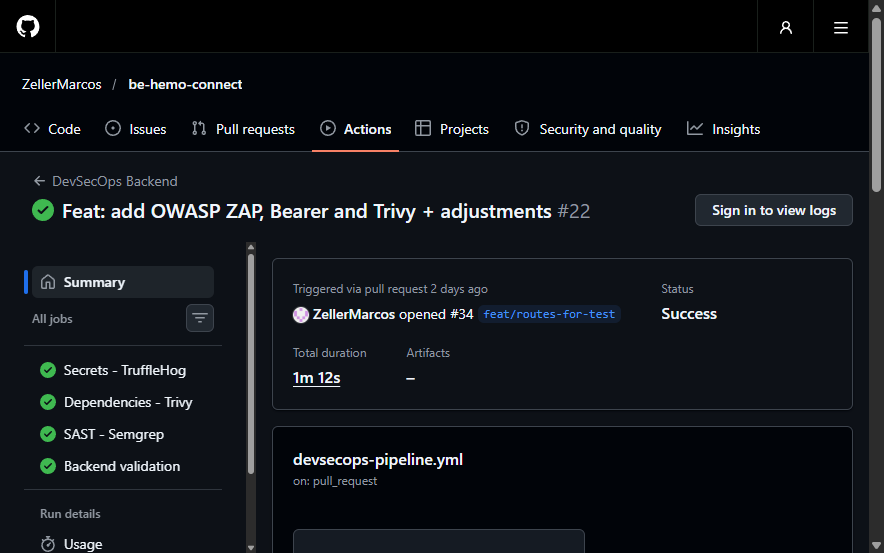
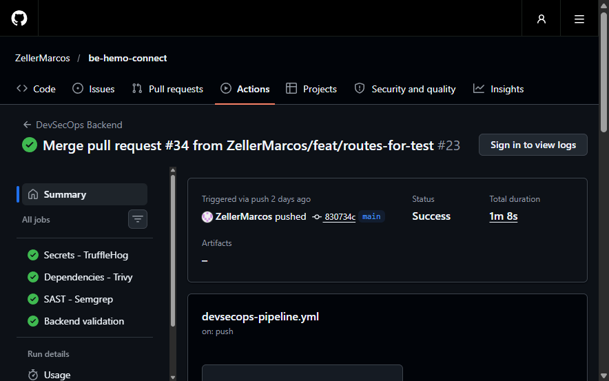
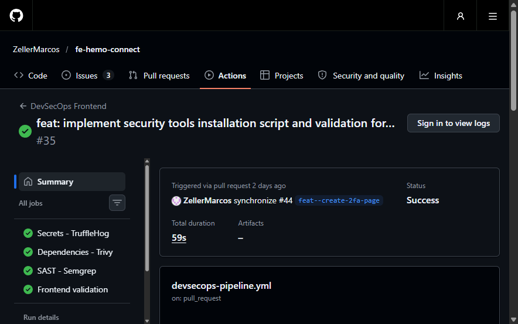
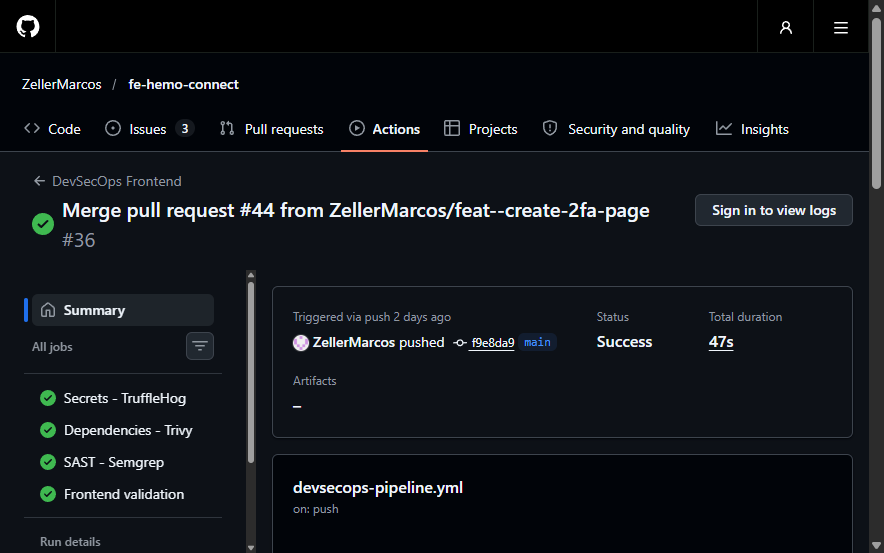
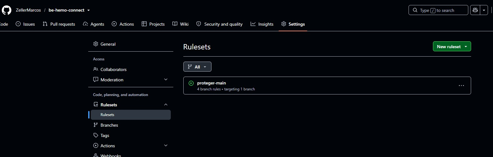
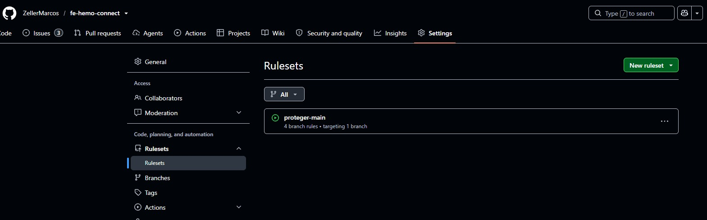

# Relatorio Tecnico DevSecOps - Hemo Connect

**Projeto:** Hemo Connect (backend `be-hemo-connect` e frontend `fe-hemo-connect`)

**Instituicao:** UMC - Ano: 2026

**Integrantes:**

- Marcos Vinicius Frazao Zeller - RA 11241103648
- William Donizetti Balbino de Morais - RA 11241102384

**Repositorios:** https://github.com/ZellerMarcos/be-hemo-connect e https://github.com/ZellerMarcos/fe-hemo-connect

**Release (versao local, data de referencia 12/11/2026):** ver `docs/releases/RELEASE_DEVSECOPS_PIPELINE.md`.

## 1. Introducao e contextualizacao

O Hemo Connect trata dados pessoais, credenciais derivadas, codigos temporarios de autenticacao e registros de auditoria. A seguranca da aplicacao nao depende apenas dos controles implementados no codigo: ela exige verificacao continua de cada mudanca antes de sua integracao na branch principal.

SecDevOps e a pratica de incorporar verificacoes de seguranca ao ciclo de desenvolvimento, executando-as automaticamente a cada alteracao. Quanto antes um segredo exposto, uma dependencia vulneravel ou um padrao inseguro e detectado, menor o custo de correcao e menor a chance de chegar a producao.

A esteira do arquivo `.github/workflows/devsecops-pipeline.yml` executa em `push` e `pull request` para `main`, alem de disparo manual. Ela nao substitui Argon2id, 2FA, controle de sessao, LGPD ou auditoria; funciona como camada preventiva complementar, junto da revisao humana.

## 2. Ferramentas adotadas

Ambos os repositorios executam as tres vertentes solicitadas, mais um job de validacao funcional (testes no backend; lint e build no frontend). Os repositorios sao publicos, mas o Semgrep OSS foi mantido por ja estar integrado e por cobrir Python e TypeScript com regras mantidas pela comunidade; o CodeQL e opcional no enunciado e nao foi adotado.

### 2.1 Secrets - TruffleHog

O TruffleHog (acao `trufflesecurity/trufflehog@v3.97.9`) varre o historico Git (checkout com `fetch-depth: 0`) em busca de credenciais. A acao executa com `--fail`, ou seja, encerra com codigo diferente de zero quando ha resultado reportado.

**Limite importante:** a esteira usa `--only-verified`, que reporta somente credenciais que o TruffleHog consegue validar junto ao servico emissor. Isso reduz falsos positivos, mas uma chave que nao possa ser validada externamente (por exemplo, uma chave AES propria ou uma senha de banco interno) pode nao ser reportada. Portanto, o job nao deve ser descrito como prova de que nenhum segredo existe; ele complementa a regra de manter chaves fora do repositorio.

### 2.2 SCA - Trivy

O Trivy (`aquasecurity/trivy-action@v0.36.0`, modo `fs`, `scanners: vuln`) analisa os manifests de dependencias (`requirements.txt` no backend e `package-lock.json` no frontend) contra bases de CVEs. Configuracao: `severity: HIGH,CRITICAL`, `ignore-unfixed: false` e `exit-code: 1`. Vulnerabilidades LOW e MEDIUM nao bloqueiam, mas devem ser acompanhadas.

**Caso real de bloqueio:** durante o desenvolvimento, o Trivy bloqueou um merge no frontend por causa de `vite 7.3.6` (CVE-2026-112942, severidade HIGH, corrigida em 7.3.7). A dependencia foi atualizada e a execucao seguinte foi aprovada. Esse caso comprova que o gate de severidade falha o job quando ha vulnerabilidade alta.

### 2.3 SAST - Semgrep OSS

O Semgrep OSS (versao fixada `1.178.0`) analisa `app` e `tests` no backend e `src` no frontend, com os conjuntos `p/owasp-top-ten` e `p/cwe-top-25`.

O Semgrep OSS classifica achados como `ERROR`, `WARNING` e `INFO`, e nao como ALTA ou CRITICA. A politica adotada trata `ERROR`, a maior severidade disponivel, como equivalente bloqueante: `--severity ERROR --error` encerra com codigo diferente de zero. `WARNING` e `INFO` nao bloqueiam. Essa correspondencia e uma decisao documentada, nao uma equivalencia oficial entre as escalas.

## 3. Integracao com o documento de requisitos

O documento-base utilizado e o `docs/Requisitos.pdf` versionado nos repositorios (4 paginas, 8 grupos de requisitos). A matriz abaixo relaciona cada grupo ao apoio que a esteira oferece. A esteira nao comprova, sozinha, o cumprimento do requisito: ela reduz o risco de regressao e gera evidencia verificavel a cada mudanca.

| Grupo de requisitos | Itens | Contribuicao da esteira | Limite |
| --- | --- | --- | --- |
| 1. Autenticacao e credenciais | 1.1 a 1.12 | Semgrep detecta padroes inseguros em fluxos de login e sessao; testes do backend validam hash, 2FA, expiracao, logout e protecao contra forca bruta; Trivy cobre bibliotecas de hash e sessao. | Nao prova parametros de custo do hash nem eficacia contra forca bruta em producao. |
| 2. Recuperacao de senha | 2.1 a 2.7 | Testes do backend cobrem token, expiracao, invalidacao e logs; Semgrep revisa o codigo do fluxo. | A qualidade criptografica do token depende de revisao de design. |
| 3. Criptografia e comunicacao | 3.1 a 3.8 | TruffleHog reduz o risco de chaves expostas (3.6); Semgrep aponta uso inseguro de APIs criptograficas (3.5); Trivy cobre bibliotecas criptograficas. | Nao comprova TLS, cifragem em repouso nem protecao de chaves em producao; `--only-verified` pode nao reportar chaves proprias. |
| 4. Conformidade com a LGPD | 4.1 a 4.11 | Semgrep e Trivy reduzem exposicao tecnica de dados; testes cobrem consentimento, consulta, exportacao e exclusao. | Nao certifica conformidade juridica com a LGPD. |
| 5. Auditoria e logs | 5.1 a 5.4 | Testes cobrem registro de eventos de autenticacao; Semgrep pode sinalizar falhas de tratamento de erros. | Nao prova protecao contra alteracao dos logs. |
| 6. Documentacao tecnico-cientifica | 6.7 a 6.10 | O historico de execucoes funciona como evidencia de testes de seguranca (6.9) e resultados (6.10). | Ameacas e riscos (6.7, 6.8) exigem analise manual. |
| 7. Resumo cientifico e 8. Poster | 7.x e 8.x | Evidencia citavel do mecanismo de verificacao continua. | Sem automacao especifica. |

Os controles descritos em `SECURITY.md`, `LGPD.md`, `AUDITORIA_E_LOGS.md` e `CHECKLIST.md` continuam sendo controles de aplicacao ou documentacao.

## 4. Arquitetura da esteira

```text
Desenvolvedor
   |  push / pull request para main
GitHub Actions - devsecops-pipeline.yml
   |
   +-- Secrets - TruffleHog (historico Git)
   +-- Dependencies - Trivy (SCA, HIGH/CRITICAL)
   +-- SAST - Semgrep (ERROR)
   +-- Validation (testes no backend; lint e build no frontend)
   |
Todos aprovados -> PR elegivel a revisao e merge
Algum job falha  -> check vermelho
```

## 5. Evidencias de funcionamento

Os dados abaixo foram consultados na API publica do GitHub. Os jobs listados terminaram com `success`.

| Repositorio | Evento | Branch | Commit | Run | Jobs aprovados |
| --- | --- | --- | --- | --- | --- |
| Backend | pull request #34 | feat/routes-for-test | cd323b0 | 41640068018 | TruffleHog, Trivy, Semgrep, Backend validation |
| Backend | push (merge) | main | 830734c | 41641064261 | TruffleHog, Trivy, Semgrep, Backend validation |
| Frontend | pull request | feat--create-2fa-page | 301d770 | 41637167606 | TruffleHog, Trivy, Semgrep, Frontend validation |
| Frontend | push (merge) | main | f9e8da9 | 41639828412 | TruffleHog, Trivy, Semgrep, Frontend validation |

URLs: `https://github.com/ZellerMarcos/be-hemo-connect/actions/runs/41641064261` e `https://github.com/ZellerMarcos/fe-hemo-connect/actions/runs/41639828412`.

**Prints de tela (Job Green):** capturas reais, feitas em 05/11/2026 nas paginas publicas das execucoes do workflow `devsecops-pipeline.yml`. Cada print mostra os quatro jobs aprovados na lista lateral (TruffleHog, Trivy, Semgrep e validacao).









A tela de checks dos PRs nao foi incluida porque, apos o merge, o GitHub deixa de exibir o bloco de checks na conversa; as execucoes do evento `pull_request` acima cumprem esse papel. As imagens da esteira avancada (ZAP, Bearer e SBOM) estao no relatorio avancado e nao substituem estas.

**Alertas de Dependabot ou CodeQL:** nao foram consultados nesta versao, pois a consulta exige autenticacao. Se existirem, devem ser registrados com identificador, severidade, componente, impacto e mitigacao, sem expor valores de credenciais.

**Teste local controlado do gate do Trivy:** em 05/11/2026, um lockfile sintetico fixando `vite 7.3.6` foi analisado com o Trivy 0.76.1 e as mesmas severidades da esteira. Resultado: CVE-2026-112942, severidade HIGH, e codigo de saida 1. Isso reproduz o bloqueio ocorrido na pipeline; nao representa vulnerabilidade presente no codigo atual, que usa `vite 7.3.7`.

## 6. Politica de bloqueio

| Categoria | Politica | Situacao verificada |
| --- | --- | --- |
| TruffleHog | Falha quando reporta credencial verificada (`--fail`). | Configurado; cobertura limitada a credenciais verificaveis. |
| Trivy LOW ou MEDIUM | Nao bloqueia. | Configurado. |
| Trivy HIGH ou CRITICAL | Bloqueia com `exit-code: 1`. | Configurado; bloqueio observado na pipeline (vite 7.3.6) e reproduzido localmente. |
| Semgrep INFO ou WARNING | Nao bloqueia. | Configurado. |
| Semgrep ERROR | Bloqueia com `--error`. | Configurado; nenhum achado ERROR nas execucoes aprovadas. |

**Protecao da branch main (Ruleset ativo):** em 05/11/2026, antes da configuracao, a API publica indicava `main` sem protecao nos dois repositorios. Em seguida foi criado, em cada repositorio, o Ruleset `proteger-main` (status Active, alvo: branch padrao `main`). A consulta publica `GET /repos/ZellerMarcos/{repositorio}/rules/branches/main` confirma as regras ativas:

| Regra | Efeito |
| --- | --- |
| Restrict deletions | Impede apagar a `main`. |
| Block force pushes | Impede reescrever o historico da `main`. |
| Require a pull request before merging | Alteracoes entram por Pull Request (0 aprovacoes exigidas). |
| Require status checks to pass | Exige `Secrets - TruffleHog`, `Dependencies - Trivy`, `SAST - Semgrep` e `Backend validation` (backend) ou `Frontend validation` (frontend), com a branch atualizada antes do merge (`strict`). |

Assim, um job vermelho (Trivy HIGH/CRITICAL, Semgrep ERROR ou segredo verificado) deixa de ser apenas um aviso e passa a impedir o merge na `main`.





**Limite:** o bloqueio ainda nao foi exercitado com um Pull Request de check vermelho apos a criacao do Ruleset; a evidencia atual e a configuracao ativa, confirmada pela API. Sem regra de aprovacao de revisores, o autor pode aprovar o proprio PR, e a lista de bypass deve permanecer vazia para a regra valer tambem para o dono do repositorio.

## 7. Resultados

- Os quatro jobs de cada repositorio foram aprovados nas execucoes de pull request e de merge listadas na secao 5.
- Houve um bloqueio real pelo Trivy no frontend (vite 7.3.6, HIGH), corrigido com a atualizacao para 7.3.7.
- Ruleset `proteger-main` ativo nos dois repositorios, exigindo Pull Request e os checks de seguranca e validacao.
- Pendencias para a entrega completa: confirmacao do documento-base e publicacao da release.

## 8. Conclusao

A esteira automatiza a verificacao de segredos, CVEs e padroes de codigo inseguro, alem de confirmar testes e build, reduzindo o risco de mudancas inseguras chegarem a `main`. Ela nao torna o sistema automaticamente seguro: revisao de codigo, rotacao de segredos, correcao de achados e, e a manutencao da protecao de branch que torna os checks obrigatorios continuam necessarias.
